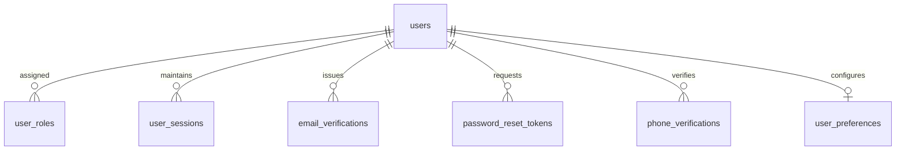

# Rydora Ride-Sharing & Carpooling Platform: Relational Database Normalization & Dependency Specification

**Document Version:** 1.0.0  
**Deliverable:** Database Normalization Specification (`normalization.md`)  
**Project:** Rydora — Community-First Ride-Sharing & Carpooling Ecosystem  
**Target Engine:** PostgreSQL 15+ / Prisma ORM v7  
**Schema Definition:** `backend/prisma/schema.prisma` (64 Relational Models, 49 Domain Enums)  
**Deliverable Context:** AP Project Checkpoint 2 (CP2)  
**Academic Cohort:** Team T0145 · Section A  
**Authors & Engineering Contributors:**
- Badal Khandelwal (Lead Backend & Database Architect)
- Anindya Sarkar (Database Administrator & Auth Specialist)
- Anshika Srivastava (Data Modeler & Systems Analyst)
- Atharv (Safety, Real-Time & Communications Engineer)

---

## Table of Contents

1. [Executive Summary & Normalization Objectives](#1-executive-summary--normalization-objectives)
2. [Theoretical Foundations of Relational Normalization](#2-theoretical-foundations-of-relational-normalization)
   - [2.1 Functional Dependencies (FDs)](#21-functional-dependencies-fds)
   - [2.2 Normal Forms Criteria (1NF through BCNF and 4NF)](#22-normal-forms-criteria-1nf-through-bcnf-and-4nf)
   - [2.3 Modification Anomalies Addressed](#23-modification-anomalies-addressed)
3. [Domain-by-Domain Normalization & Functional Dependency Analysis](#3-domain-by-domain-normalization--functional-dependency-analysis)
   - [Module 1: Identity, Authentication & Preferences](#module-1-identity-authentication--preferences-7-entities)
   - [Module 2: Communities, Domain Verification & Membership](#module-2-communities-domain-verification--membership-6-entities)
   - [Module 3: Fleet & Driver Management](#module-3-fleet--driver-management-3-entities)
   - [Module 4: Rides, Routes, Stops & Waypoints](#module-4-rides-routes-stops--waypoints-4-entities)
   - [Module 5: Bookings, Dynamic Quotes & Cancellations](#module-5-bookings-dynamic-quotes--cancellations-8-entities)
   - [Module 6: Financial Ledger, Escrow & Earnings](#module-6-financial-ledger-escrow--earnings-6-entities)
   - [Module 7: Safety, Real-Time Telemetry, SOS & Evidence](#module-7-safety-real-time-telemetry-sos--evidence-7-entities)
   - [Module 8: Ratings, Reviews, AI Feedback & Driver Tiers](#module-8-ratings-reviews-ai-feedback--driver-tiers-8-entities)
   - [Module 9: Multi-Channel Notifications & Preferences](#module-9-multi-channel-notifications--preferences-3-entities)
   - [Module 10: External Calendar Integrations](#module-10-external-calendar-integrations-2-entities)
   - [Module 11: Artificial Intelligence Services](#module-11-artificial-intelligence-services-3-entities)
   - [Module 12: Ecological Sustainability & Green Rewards](#module-12-ecological-sustainability--green-rewards-4-entities)
   - [Module 13: Platform Administration & Dynamic Policies](#module-13-platform-administration--dynamic-policies-3-entities)
4. [Lossless Join Decomposition & Dependency Preservation Proofs](#4-lossless-join-decomposition--dependency-preservation-proofs)
5. [Multi-Valued Dependency (4NF) & Join Dependency (5NF) Analysis](#5-multi-valued-dependency-4nf--join-dependency-5nf-analysis)
6. [Controlled Semi-Structured Attributes (JSON Justification)](#6-controlled-semi-structured-attributes-json-justification)
7. [Comprehensive Entity Relationship & Referential Cardinality Matrix](#7-comprehensive-entity-relationship--referential-cardinality-matrix)
8. [Conclusion & Production Readiness Verification](#8-conclusion--production-readiness-verification)

---

## 1. Executive Summary & Normalization Objectives

The **Rydora** database architecture is designed as an enterprise-grade, highly normalized relational foundation supporting a community-driven ride-sharing platform. Built upon PostgreSQL 15+ and managed via Prisma ORM, the physical schema consists of:
- **64 Distinct Relational Tables**
- **49 Strongly-Typed Domain Enums**
- **100% Cryptographic UUID Primary Keys** (`UUIDv4`) to eliminate enumeration attacks and partition bottlenecks.

The primary objective of this normalization specification is to formally demonstrate that the Rydora schema:
1. **Eliminates Redundancy:** Prevents duplicate facts from being stored across multiple rows or tables.
2. **Prevents Update, Insertion, and Deletion Anomalies:** Guarantees that updating a user attribute, deleting a vehicle, or cancelling a booking does not corrupt surrounding relational integrity or orphan historical audit logs.
3. **Achieves Boyce-Codd Normal Form (BCNF) / Third Normal Form (3NF):** Verifies that every determinant attribute is a candidate key for all functional dependencies.
4. **Guarantees Lossless Join Decomposition:** Proves that decomposes of complex domain entities (e.g., decomposing a raw Ride into `Ride`, `RideRoute`, `RideStop`, and `RideCommunity`) retain mathematical equivalence and can be reconstituted without spurious tuples.
5. **Maintains Financial & Safety Immutability:** Enforces strict separation between mutable operational states and immutable historical snapshots (e.g., `BookingCommunityEligibility`, `FareQuote`, `LedgerEntry`, and `SafetyEvidence`).

---

## 2. Theoretical Foundations of Relational Normalization

### 2.1 Functional Dependencies (FDs)
Given a relational schema $R$ and subsets of attributes $X, Y \subseteq R$, a **Functional Dependency** denoted as:
$$X \rightarrow Y$$
holds over $R$ if and only if for any two valid tuples $t_1, t_2 \in R$:
$$t_1[X] = t_2[X] \implies t_1[Y] = t_2[Y]$$
In Rydora, $X$ constitutes a **Superkey** if $X \rightarrow R$. If no proper subset $X' \subset X$ functionally determines $R$, then $X$ is a **Candidate Key** ($CK$). The primary key ($PK$) is chosen as a surrogate UUID from the set of candidate keys.

### 2.2 Normal Forms Criteria (1NF through BCNF and 4NF)

#### First Normal Form (1NF)
A relation $R$ is in **1NF** if and only if:
1. All underlying attribute domains contain purely atomic (indivisible) values.
2. There are no repeating groups or composite multivalued arrays stored in scalar columns.
3. Each record is uniquely identifiable by a primary key.

*Rydora Compliance:* All scalar columns adhere to strict SQL primitive types (`VARCHAR`, `INTEGER`, `DECIMAL(10,2)`, `BOOLEAN`, `TIMESTAMP`, `UUID`). No comma-separated strings or unstructured arrays are used for core relationships.

#### Second Normal Form (2NF)
A relation $R$ is in **2NF** if and only if:
1. $R$ is in 1NF.
2. Every non-prime attribute $A \in R$ is **fully functionally dependent** on the primary key (i.e., no non-prime attribute is functionally dependent on a proper subset of any candidate key).

*Rydora Compliance:* Candidate keys that are composite (such as `(userId, role)` in `UserRole`, `(userId, communityId)` in `CommunityMembership`, or `(rideId, sequence)` in `RideStop`) only functionally determine attributes that depend on the full composite key. All single-attribute primary keys automatically satisfy 2NF.

#### Third Normal Form (3NF)
A relation $R$ is in **3NF** if and only if:
1. $R$ is in 2NF.
2. For every non-trivial functional dependency $X \rightarrow A$:
   - Either $X$ is a Superkey of $R$, OR
   - $A$ is a Prime Attribute (member of a candidate key).
Equivalently: No non-prime attribute is transitively dependent on any candidate key ($CK \rightarrow Y \rightarrow A$).

#### Boyce-Codd Normal Form (BCNF)
A relation $R$ is in **BCNF** if and only if:
- For every non-trivial functional dependency $X \rightarrow A$, $X$ is a **Superkey** of $R$.
BCNF removes any lingering anomalies present in 3NF when multiple overlapping candidate keys exist.

#### Fourth Normal Form (4NF)
A relation $R$ is in **4NF** if and only if:
- For every non-trivial multi-valued dependency $X \twoheadrightarrow Y$, $X$ is a Superkey.
This ensures independent multi-valued facts (e.g., a Driver having multiple Vehicles AND multiple Community Memberships) are not bundled into a single entity, which would cause Cartesian product anomalies.

### 2.3 Modification Anomalies Addressed

| Anomaly Class | Problem Description in Unnormalized Systems | Rydora Relational Solution |
|---|---|---|
| **Insertion Anomaly** | Cannot record a community or vehicle without simultaneously associating a rider or ride. | Decomposed into dedicated `communities`, `vehicles`, and `driver_profiles` tables with independent lifecycles. |
| **Deletion Anomaly** | Deleting a completed ride deletes the vehicle's registration or the user's historical profile. | Referential integrity using `ON DELETE RESTRICT` on historical rides, bookings, and financial accounts. |
| **Update Anomaly** | Changing a user's phone number or a community's name requires updating thousands of ride rows. | Single source of truth: `users.phone` and `communities.name` are referenced only by foreign key UUIDs. |

---

## 3. Domain-by-Domain Normalization & Functional Dependency Analysis

---

### Module 1: Identity, Authentication & Preferences (7 Entities)

#### 1.1 `users`
- **Primary Key ($PK$):** `userId` (`UUID`)
- **Candidate Keys ($CK$):** `userId`, `email`, `phone` (where not null)
- **Attributes:** `userId`, `name`, `email`, `phone`, `phoneVerifiedAt`, `passwordHash`, `profileImage`, `accountStatus`, `emailVerifiedAt`, `createdAt`, `updatedAt`, `deletedAt`
- **Functional Dependencies:**
  - $FD_1: \text{userId} \rightarrow \{\text{name}, \text{email}, \text{phone}, \text{phoneVerifiedAt}, \text{passwordHash}, \text{profileImage}, \text{accountStatus}, \text{emailVerifiedAt}, \text{createdAt}, \text{updatedAt}, \text{deletedAt}\}$
  - $FD_2: \text{email} \rightarrow \{\text{userId}, \dots\}$
  - $FD_3: \text{phone} \rightarrow \{\text{userId}, \dots\}$
- **Normal Form:** **BCNF** (All determinants `userId`, `email`, `phone` are superkeys).
- **Relational Integrity:** Soft delete supported via `deletedAt` without orphaning historical child foreign keys.

#### 1.2 `user_roles`
- **Primary Key ($PK$):** `roleId` (`UUID`)
- **Candidate Keys ($CK$):** `roleId`, `(userId, role)`
- **Foreign Keys ($FK$):** `userId \rightarrow users(userId)` (`ON DELETE CASCADE`)
- **Attributes:** `roleId`, `userId`, `role`, `createdAt`
- **Functional Dependencies:**
  - $FD_1: \text{roleId} \rightarrow \{\text{userId}, \text{role}, \text{createdAt}\}$
  - $FD_2: (\text{userId}, \text{role}) \rightarrow \{\text{roleId}, \text{createdAt}\}$
- **Normal Form:** **BCNF** (Both `roleId` and composite `(userId, role)` are superkeys). Prevents duplicate role assignment per user.

#### 1.3 `user_sessions`
- **Primary Key ($PK$):** `sessionId` (`UUID`)
- **Candidate Keys ($CK$):** `sessionId`, `refreshTokenHash`
- **Foreign Keys ($FK$):** `userId \rightarrow users(userId)` (`ON DELETE CASCADE`)
- **Attributes:** `sessionId`, `userId`, `refreshTokenHash`, `deviceInfo`, `ipAddress`, `expiresAt`, `revokedAt`, `createdAt`
- **Functional Dependencies:**
  - $FD_1: \text{sessionId} \rightarrow \{\text{userId}, \text{refreshTokenHash}, \text{deviceInfo}, \text{ipAddress}, \text{expiresAt}, \text{revokedAt}, \text{createdAt}\}$
  - $FD_2: \text{refreshTokenHash} \rightarrow \{\text{sessionId}, \dots\}$
- **Normal Form:** **BCNF**. Token hash is strictly unique.

#### 1.4 `email_verifications`
- **Primary Key ($PK$):** `verificationId` (`UUID`)
- **Candidate Keys ($CK$):** `verificationId`, `tokenHash`
- **Foreign Keys ($FK$):** `userId \rightarrow users(userId)` (`ON DELETE CASCADE`)
- **Attributes:** `verificationId`, `userId`, `tokenHash`, `expiresAt`, `usedAt`, `createdAt`
- **Normal Form:** **BCNF**. Single-responsibility token isolation.

#### 1.5 `password_reset_tokens`
- **Primary Key ($PK$):** `resetId` (`UUID`)
- **Candidate Keys ($CK$):** `resetId`, `tokenHash`
- **Foreign Keys ($FK$):** `userId \rightarrow users(userId)` (`ON DELETE CASCADE`)
- **Attributes:** `resetId`, `userId`, `tokenHash`, `expiresAt`, `usedAt`, `createdAt`
- **Normal Form:** **BCNF**. Independent token lifecycle.

#### 1.6 `phone_verifications`
- **Primary Key ($PK$):** `verificationId` (`UUID`)
- **Candidate Keys ($CK$):** `verificationId`
- **Foreign Keys ($FK$):** `userId \rightarrow users(userId)` (`ON DELETE CASCADE`)
- **Attributes:** `verificationId`, `userId`, `phone`, `otpHash`, `expiresAt`, `verifiedAt`, `attemptCount`, `createdAt`
- **Normal Form:** **BCNF**.

#### 1.7 `user_preferences`
- **Primary Key ($PK$):** `preferenceId` (`UUID`)
- **Candidate Keys ($CK$):** `preferenceId`, `userId`
- **Foreign Keys ($FK$):** `userId \rightarrow users(userId)` (`ON DELETE CASCADE`)
- **Attributes:** `preferenceId`, `userId`, `language`, `theme`, `accessibilitySettings`, `createdAt`, `updatedAt`
- **Normal Form:** **BCNF**. One-to-one vertical partitioning of UI preferences out of the hot `users` row.

---

### Module 2: Communities, Domain Verification & Membership (6 Entities)

⁠ mermaid
erDiagram
    communities ||--o{ community_domains : "authenticates_via"
    communities ||--o{ community_invites : "distributes"
    communities ||--o{ community_memberships : "enrolls"
    community_memberships ||--o{ community_verifications : "audits"
    community_memberships ||--o{ booking_community_eligibilities : "validates"
 ⁠

#### 2.1 ⁠ communities ⁠
•⁠  ⁠*Primary Key ($PK$):* ⁠ communityId ⁠ (⁠ UUID ⁠)
•⁠  ⁠*Candidate Keys ($CK$):* ⁠ communityId ⁠
•⁠  ⁠*Foreign Keys ($FK$):* ⁠ createdById \rightarrow users(userId) ⁠ (⁠ ON DELETE RESTRICT ⁠)
•⁠  ⁠*Attributes:* ⁠ communityId ⁠, ⁠ name ⁠, ⁠ type ⁠, ⁠ description ⁠, ⁠ status ⁠, ⁠ isDiscoverable ⁠, ⁠ createdById ⁠, ⁠ createdAt ⁠, ⁠ updatedAt ⁠
•⁠  ⁠*Functional Dependencies:* $\text{communityId} \rightarrow \text{All attributes}$
•⁠  ⁠*Normal Form:* *BCNF*.

#### 2.2 ⁠ community_memberships ⁠
•⁠  ⁠*Primary Key ($PK$):* ⁠ membershipId ⁠ (⁠ UUID ⁠)
•⁠  ⁠*Candidate Keys ($CK$):* ⁠ membershipId ⁠, ⁠ (userId, communityId) ⁠
•⁠  ⁠*Foreign Keys ($FK$):*
  - ⁠ userId \rightarrow users(userId) ⁠ (⁠ ON DELETE CASCADE ⁠)
  - ⁠ communityId \rightarrow communities(communityId) ⁠ (⁠ ON DELETE CASCADE ⁠)
•⁠  ⁠*Attributes:* ⁠ membershipId ⁠, ⁠ userId ⁠, ⁠ communityId ⁠, ⁠ membershipStatus ⁠, ⁠ membershipRole ⁠, ⁠ verificationStatus ⁠, ⁠ verificationMethod ⁠, ⁠ verifiedAt ⁠, ⁠ joinedAt ⁠, ⁠ createdAt ⁠, ⁠ updatedAt ⁠
•⁠  ⁠*Functional Dependencies:*
  - $FD_1: \text{membershipId} \rightarrow \{\text{userId}, \text{communityId}, \text{membershipStatus}, \dots\}$
  - $FD_2: (\text{userId}, \text{communityId}) \rightarrow \{\text{membershipId}, \dots\}$
•⁠  ⁠*Normal Form:* *BCNF*. Eliminates M:N redundancy between Users and Communities.

#### 2.3 ⁠ community_domains ⁠
•⁠  ⁠*Primary Key ($PK$):* ⁠ domainId ⁠ (⁠ UUID ⁠)
•⁠  ⁠*Candidate Keys ($CK$):* ⁠ domainId ⁠, ⁠ (communityId, domain) ⁠
•⁠  ⁠*Foreign Keys ($FK$):* ⁠ communityId \rightarrow communities(communityId) ⁠ (⁠ ON DELETE CASCADE ⁠)
•⁠  ⁠*Attributes:* ⁠ domainId ⁠, ⁠ communityId ⁠, ⁠ domain ⁠, ⁠ isActive ⁠, ⁠ approvedAt ⁠, ⁠ createdAt ⁠
•⁠  ⁠*Normal Form:* *BCNF*. Isolates email domain rules (1:N) from community metadata.

#### 2.4 ⁠ community_invites ⁠
•⁠  ⁠*Primary Key ($PK$):* ⁠ inviteId ⁠ (⁠ UUID ⁠)
•⁠  ⁠*Candidate Keys ($CK$):* ⁠ inviteId ⁠, ⁠ codeHash ⁠
•⁠  ⁠*Foreign Keys ($FK$):*
  - ⁠ communityId \rightarrow communities(communityId) ⁠ (⁠ ON DELETE CASCADE ⁠)
  - ⁠ createdById \rightarrow users(userId) ⁠ (⁠ ON DELETE RESTRICT ⁠)
•⁠  ⁠*Attributes:* ⁠ inviteId ⁠, ⁠ communityId ⁠, ⁠ createdById ⁠, ⁠ codeHash ⁠, ⁠ emailRestriction ⁠, ⁠ maxUses ⁠, ⁠ useCount ⁠, ⁠ expiresAt ⁠, ⁠ revokedAt ⁠, ⁠ createdAt ⁠
•⁠  ⁠*Normal Form:* *BCNF*.

#### 2.5 ⁠ community_verifications ⁠
•⁠  ⁠*Primary Key ($PK$):* ⁠ verificationId ⁠ (⁠ UUID ⁠)
•⁠  ⁠*Candidate Keys ($CK$):* ⁠ verificationId ⁠
•⁠  ⁠*Foreign Keys ($FK$):*
  - ⁠ membershipId \rightarrow community_memberships(membershipId) ⁠ (⁠ ON DELETE CASCADE ⁠)
  - ⁠ reviewerId \rightarrow users(userId) ⁠ (⁠ ON DELETE SET NULL ⁠)
•⁠  ⁠*Attributes:* ⁠ verificationId ⁠, ⁠ membershipId ⁠, ⁠ method ⁠, ⁠ status ⁠, ⁠ reviewerId ⁠, ⁠ reviewedAt ⁠, ⁠ reason ⁠, ⁠ metadata ⁠, ⁠ createdAt ⁠
•⁠  ⁠*Normal Form:* *BCNF*. Separates verification audit log from current membership status, avoiding repeating groups.

#### 2.6 ⁠ booking_community_eligibilities ⁠
•⁠  ⁠*Primary Key ($PK$):* ⁠ eligibilityId ⁠ (⁠ UUID ⁠)
•⁠  ⁠*Candidate Keys ($CK$):* ⁠ eligibilityId ⁠, ⁠ (bookingId, communityId) ⁠
•⁠  ⁠*Foreign Keys ($FK$):*
  - ⁠ bookingId \rightarrow bookings(bookingId) ⁠ (⁠ ON DELETE CASCADE ⁠)
  - ⁠ communityId \rightarrow communities(communityId) ⁠ (⁠ ON DELETE RESTRICT ⁠)
  - ⁠ membershipId \rightarrow community_memberships(membershipId) ⁠ (⁠ ON DELETE RESTRICT ⁠)
•⁠  ⁠*Attributes:* ⁠ eligibilityId ⁠, ⁠ bookingId ⁠, ⁠ communityId ⁠, ⁠ membershipId ⁠, ⁠ verificationStatus ⁠, ⁠ snapshotAt ⁠, ⁠ eligibilitySnapshot ⁠
•⁠  ⁠*Normal Form:* *BCNF. **Crucial architectural snapshot:* preserves historical proof that rider was verified at booking confirmation time even if membership is revoked later.

---

### Module 3: Fleet & Driver Management (3 Entities)

#### 3.1 ⁠ vehicles ⁠
•⁠  ⁠*Primary Key ($PK$):* ⁠ vehicleId ⁠ (⁠ UUID ⁠)
•⁠  ⁠*Candidate Keys ($CK$):* ⁠ vehicleId ⁠, ⁠ registrationNumber ⁠
•⁠  ⁠*Foreign Keys ($FK$):* ⁠ ownerId \rightarrow users(userId) ⁠ (⁠ ON DELETE CASCADE ⁠)
•⁠  ⁠*Attributes:* ⁠ vehicleId ⁠, ⁠ ownerId ⁠, ⁠ vehicleType ⁠, ⁠ registrationNumber ⁠, ⁠ make ⁠, ⁠ model ⁠, ⁠ color ⁠, ⁠ seatCapacity ⁠, ⁠ verificationStatus ⁠, ⁠ isActive ⁠, ⁠ createdAt ⁠, ⁠ updatedAt ⁠
•⁠  ⁠*Functional Dependencies:*
  - $FD_1: \text{vehicleId} \rightarrow \text{All attributes}$
  - $FD_2: \text{registrationNumber} \rightarrow \text{All attributes}$
•⁠  ⁠*Normal Form:* *BCNF*.

#### 3.2 ⁠ driver_profiles ⁠
•⁠  ⁠*Primary Key ($PK$):* ⁠ driverProfileId ⁠ (⁠ UUID ⁠)
•⁠  ⁠*Candidate Keys ($CK$):* ⁠ driverProfileId ⁠, ⁠ userId ⁠
•⁠  ⁠*Foreign Keys ($FK$):* ⁠ userId \rightarrow users(userId) ⁠ (⁠ ON DELETE CASCADE ⁠)
•⁠  ⁠*Attributes:* ⁠ driverProfileId ⁠, ⁠ userId ⁠, ⁠ driverVerificationStatus ⁠, ⁠ licenseVerificationStatus ⁠, ⁠ licenseNumber ⁠, ⁠ eligibilityStatus ⁠, ⁠ approvedAt ⁠, ⁠ createdAt ⁠, ⁠ updatedAt ⁠
•⁠  ⁠*Normal Form:* *BCNF*. Isolates driver eligibility from basic user registration.

#### 3.3 ⁠ vehicle_documents ⁠
•⁠  ⁠*Primary Key ($PK$):* ⁠ documentId ⁠ (⁠ UUID ⁠)
•⁠  ⁠*Candidate Keys ($CK$):* ⁠ documentId ⁠
•⁠  ⁠*Foreign Keys ($FK$):*
  - ⁠ vehicleId \rightarrow vehicles(vehicleId) ⁠ (⁠ ON DELETE CASCADE ⁠)
  - ⁠ reviewedById \rightarrow users(userId) ⁠ (⁠ ON DELETE SET NULL ⁠)
•⁠  ⁠*Attributes:* ⁠ documentId ⁠, ⁠ vehicleId ⁠, ⁠ documentType ⁠, ⁠ fileUrl ⁠, ⁠ verificationStatus ⁠, ⁠ reviewedById ⁠, ⁠ reviewedAt ⁠, ⁠ expiresAt ⁠, ⁠ rejectionReason ⁠, ⁠ createdAt ⁠, ⁠ updatedAt ⁠
•⁠  ⁠*Normal Form:* *BCNF*. Eliminates repeating document groups from the vehicle entity.

---

#### 4.1 `rides`
- **Primary Key ($PK$):** `rideId` (`UUID`)
- **Candidate Keys ($CK$):** `rideId`
- **Foreign Keys ($FK$):**
  - `driverId \rightarrow users(userId)` (`ON DELETE RESTRICT`)
  - `vehicleId \rightarrow vehicles(vehicleId)` (`ON DELETE RESTRICT`)
- **Attributes:** `rideId`, `driverId`, `vehicleId`, `originAddress`, `originLat`, `originLng`, `originPlaceId`, `destinationAddress`, `destinationLat`, `destinationLng`, `destinationPlaceId`, `departureTime`, `totalSeats`, `availableSeats`, `farePerSeat`, `rideStatus`, `plannedDistanceKm`, `plannedDurationMinutes`, `notes`, `createdAt`, `updatedAt`
- **Normal Form:** **BCNF**.

#### 4.2 `ride_communities`
- **Primary Key ($PK$):** `rideCommunityId` (`UUID`)
- **Candidate Keys ($CK$):** `rideCommunityId`, `(rideId, communityId)`
- **Foreign Keys ($FK$):**
  - `rideId \rightarrow rides(rideId)` (`ON DELETE CASCADE`)
  - `communityId \rightarrow communities(communityId)` (`ON DELETE CASCADE`)
- **Attributes:** `rideCommunityId`, `rideId`, `communityId`, `createdAt`
- **Normal Form:** **BCNF**. Pure join table resolving M:N ride-to-community visibility without multi-valued dependencies.

#### 4.3 `ride_stops`
- **Primary Key ($PK$):** `stopId` (`UUID`)
- **Candidate Keys ($CK$):** `stopId`, `(rideId, sequence)`
- **Foreign Keys ($FK$):** `rideId \rightarrow rides(rideId)` (`ON DELETE CASCADE`)
- **Attributes:** `stopId`, `rideId`, `stopType`, `address`, `latitude`, `longitude`, `placeId`, `sequence`, `estimatedArrivalTime`, `createdAt`
- **Functional Dependencies:**
  - $FD_1: \text{stopId} \rightarrow \text{All attributes}$
  - $FD_2: (\text{rideId}, \text{sequence}) \rightarrow \{\text{stopId}, \text{stopType}, \text{address}, \dots\}$
- **Normal Form:** **BCNF**. Stop sequence uniqueness guaranteed per ride.

#### 4.4 `ride_routes`
- **Primary Key ($PK$):** `routeId` (`UUID`)
- **Candidate Keys ($CK$):** `routeId`, `rideId`
- **Foreign Keys ($FK$):** `rideId \rightarrow rides(rideId)` (`ON DELETE CASCADE`)
- **Attributes:** `routeId`, `rideId`, `encodedPolyline`, `distanceMeters`, `durationSeconds`, `routeProvider`, `routeMetadata`, `createdAt`, `updatedAt`
- **Normal Form:** **BCNF**. Decomposes heavy geographic polyline data away from the frequently queried `rides` table (1:1 vertical partition).

---